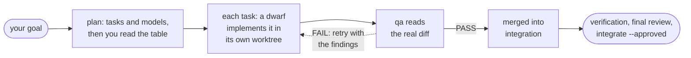

<h1 align="center">forge</h1>

<p align="center">
  <b>Multi-model coding with a reviewer that reads the code: plan, build in parallel worktrees, review every real diff, merge only what passes.</b>
</p>

<p align="center">A skill for Claude Code, Codex, OpenCode, OpenClaude, Antigravity and Grok.</p>

<p align="center">
  <a href="https://www.npmjs.com/package/@giamme/forge"></a>
  <a href="https://github.com/Giamme/forge/releases"></a>
  <a href="LICENSE"></a>
  <a href="CHANGELOG.md"></a>
</p>

<p align="center">
  <a href="#install">Install</a> ·
  <a href="#quick-start">Quick start</a> ·
  <a href="#how-it-works">How it works</a> ·
  <a href="#forge-ui">forge-ui</a> ·
  <a href="docs/README.md">Docs</a> ·
  <a href="CHANGELOG.md">Changelog</a>
</p>

<p align="center">
  
</p>
<p align="center"><sub>The run from <a href="#quick-start">Quick start</a> in <a href="#forge-ui">forge-ui</a>: its tasks in the waves the plan gave them, then as they really ran, the failed attempts and their retries included. Demo data.</sub></p>

---

You hand forge a coding goal and pick the models. **Dwarves** implement it. A **qa** reviewer
reads each dwarf's real diff, never the dwarf's summary of its own work. A model grading its own
homework isn't a check: the second stage is worth having because it sees the code, not the claim.

- **Any model, any CLI.** `--dwarf sol:xhigh --qa opus` runs GPT through Codex and Claude Opus
  through Claude Code in one command, from whichever CLI you are in. → [Models](docs/models.md)
- **Parallel when you want it.** `--decompose-level` splits the goal into tasks, routes each to a
  model by difficulty, and runs them concurrently in isolated git worktrees.
  → [Decomposed runs](docs/decomposed-runs.md)
- **Only reviewed work merges.** Every task is reviewed on its own diff. A failed task keeps its
  branch for a retry with the reviewer's findings, and only passing tasks merge.
  → [Reviews](docs/reviews.md)
- **You decide what gets spent and what lands.** A decomposed run shows you the task table and
  stops before any dispatch. Solo changes stay uncommitted, decomposed work lands on your branch
  only through `integrate --approved`, and forge never pushes. → [Safety](docs/safety.md)
- **It learns your repo.** What a run discovers goes into a small `.forge/memory.md`, and every
  later run is given it. → [Project memory](docs/memory.md)
- **You can watch it live.** forge-ui draws every run in 3D, with diffs, findings and a model
  leaderboard. → [forge-ui](docs/forge-ui.md)

## Install

```bash
npm install -g @giamme/forge
forge install                  # links forge into every agent CLI it finds
```

Update with `npm install -g @giamme/forge@latest && forge install`. Or install from a git
checkout:

```bash
git clone https://github.com/Giamme/forge.git ~/.claude/skills/forge
bash ~/.claude/skills/forge/scripts/forge-install.sh
```

forge runs on macOS and Linux. It needs bash, git, Python 3.9 or later, and the agent CLIs
you route models through; [the doctor](docs/install.md#check-what-forge-can-reach) shows which
ones it can reach. Foundry's `forge` shares the name: see
[the Foundry note](docs/install.md#from-npm).

→ [Install and update](docs/install.md)

## Quick start

Inside any agent CLI where forge is installed:

```text
/forge "add retry with exponential backoff to the HTTP client" --dwarf sol:high
```

That's the whole minimum. `sol` builds it at `high` effort on Codex, `opus` reviews the diff at
`xhigh` (the default reviewer), and you get back a summary of the change plus qa's findings.

```text
# pick both sides
/forge "fix the off-by-one in the pagination cursor" --dwarf luna:max --qa sol:xhigh

# the same model, through a different CLI
/forge "port the config loader to TOML" --dwarf sol:high:openclaude --qa opus

# let the dwarf leave the sandbox to install deps and run the suite
/forge "add integration tests against a real Postgres container" --dwarf sol:xhigh --yolo-dwarf

# several dwarves in parallel, routed by difficulty
/forge "add auth: middleware, token model, login route, and docs" \
  --decompose-level medium \
  --dwarf-high sol:xhigh --dwarf-low gemini:low:antigravity --dwarf luna:high
```

A decomposed run plans the tasks, rates and routes each one, then **shows you the table and
stops** before spending anything. Before an interactive run, forge also asks whether to use
[Fractal](docs/fractal.md) and whether to open [forge-ui](docs/forge-ui.md).

→ [Every flag, with more examples](docs/commands.md)

## How it works



Without `--decompose-level`, the whole goal is one task: one dwarf, and one review of its diff.
With optional [Fractal execution](docs/fractal.md), an implementer can delegate bounded child
tasks inside the paths it owns. forge still reviews the combined diff.

Every model is named by one spec, `alias:effort:harness`. Each field after the alias is optional:

| Spec | Means |
|---|---|
| `sol` | `sol` at the role's default effort, on its default CLI (codex) |
| `sol:xhigh` | the same model at `xhigh` effort |
| `sol:xhigh:openclaude` | the same model and effort, run through `openclaude` |

Either role can run through any of six agent CLIs:

| | codex | claude | openclaude | opencode | antigravity | grok |
|---|---|---|---|---|---|---|
| binary | `codex` | `claude` | `openclaude` | `opencode` | `agy` | `grok` |

→ [Effort ladders, clamping, sandboxes and adding a model](docs/models.md)

## forge-ui

forge-ui is an opt-in, read-only local page that watches any run live, drawn as a 3D map. It
shows every run on one plate, tasks in their waves and as they really ran, and the prompt, model,
timings and P0–P3 findings behind every step. forge offers it at the start of every new run and
never opens it without a yes.

<p align="center">
  
</p>

<table>
<tr>
<td width="50%" valign="top"><br><b>A run, as planned.</b> Tasks in their waves with dependency cables, ending in integration, verification and the final review. Click a task to open its attempts, dwarves and reviews.</td>
<td width="50%" valign="top"><br><b>And as it ran.</b> One block per attempt in the lane it ran in, failed ones in red, against <code>--max-parallel</code>; the inspector names the critical path.</td>
</tr>
<tr>
<td valign="top"><br><b>Findings on their lines.</b> Any diff of a task, or exactly the diff one reviewer read, with each P0–P3 finding under the line it names.</td>
<td valign="top"><br><b>Models, measured on your runs.</b> First-attempt pass rate with a confidence interval, retries, escalations, time and tokens; reviewers' verdicts and shadow agreement.</td>
</tr>
<tr>
<td valign="top"><br><b>Who touched which file.</b> Planned, changed, drifted into or conflicted on, wave by wave; a cell opens that file's diff.</td>
<td valign="top"><br><b>Every run, by repo.</b> One block per run with a lamp per task, filtered by state, repo, model, age or review verdict.</td>
</tr>
</table>

To look around before your first run, open it on made-up runs (the ones pictured here) from a
git checkout:

```sh
python3 ui/tools/demo_runs.py /tmp/forge-demo
(cd ui && python3 -m forge_ui --no-registry --root /tmp/forge-demo --open)
```

→ [forge-ui](docs/forge-ui.md)

## Documentation

| Page | What's in it |
|---|---|
| [Install and update](docs/install.md) | npm or a git checkout, the doctor, what the installer does per CLI, updating |
| [Command reference](docs/commands.md) | every `/forge` flag with examples, the `forge` command, the runner scripts and their exit codes |
| [Models, efforts and harnesses](docs/models.md) | the `alias:effort:harness` spec, effort ladders and clamping, yolo mode, the model registry |
| [Decomposed runs](docs/decomposed-runs.md) | decompose levels and difficulty, routing, waves, capsules, planning, resuming, split and combine, `tasks.tsv` |
| [Reviews, retries and recovery](docs/reviews.md) | verdicts, retries, infrastructure stops, severity thresholds, accepting, whole-run and shadow reviews, guards, verification, fail-first |
| [Fractal execution](docs/fractal.md) | the optional nested-execution backend: install, run, inspect, bounds and recovery |
| [Project memory](docs/memory.md) | `.forge/memory.md` and the ledger, what each role is told, whether to commit it, spend |
| [forge-ui](docs/forge-ui.md) | the run viewer: commands, the shared server, environment variables, privacy |
| [Run dataset](docs/dataset.md) | every run's inputs and outcomes, kept for training decision models |
| [Run artifacts](docs/artifacts.md) | the run directory, a plan's files, worktrees and branches |
| [Safety](docs/safety.md) | what forge never does to your branch, preconditions, execution integrity |
| [Ripwire and Jev](docs/add-ons.md) | optional repository context and advisory judgments |
| [Troubleshooting](docs/troubleshooting.md) | symptoms, causes and fixes |
| [Development](docs/development.md) | repository layout, offline checks, runtime measurement |

## License

forge is released under the [MIT License](LICENSE). forge-ui's 3D view ports code from
archivision, iso-glow and iso-figure, all MIT-licensed; their notices are in
[ui/THIRD_PARTY_NOTICES.md](ui/THIRD_PARTY_NOTICES.md).
