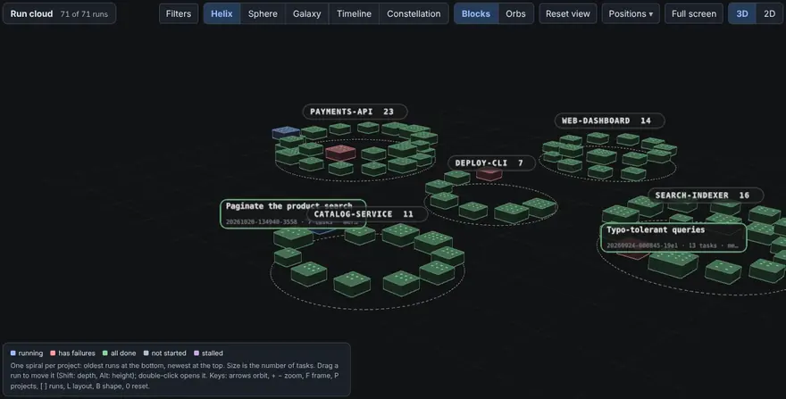
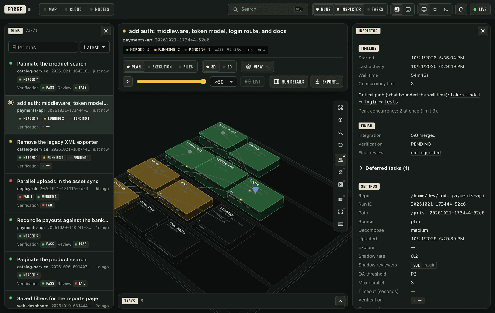
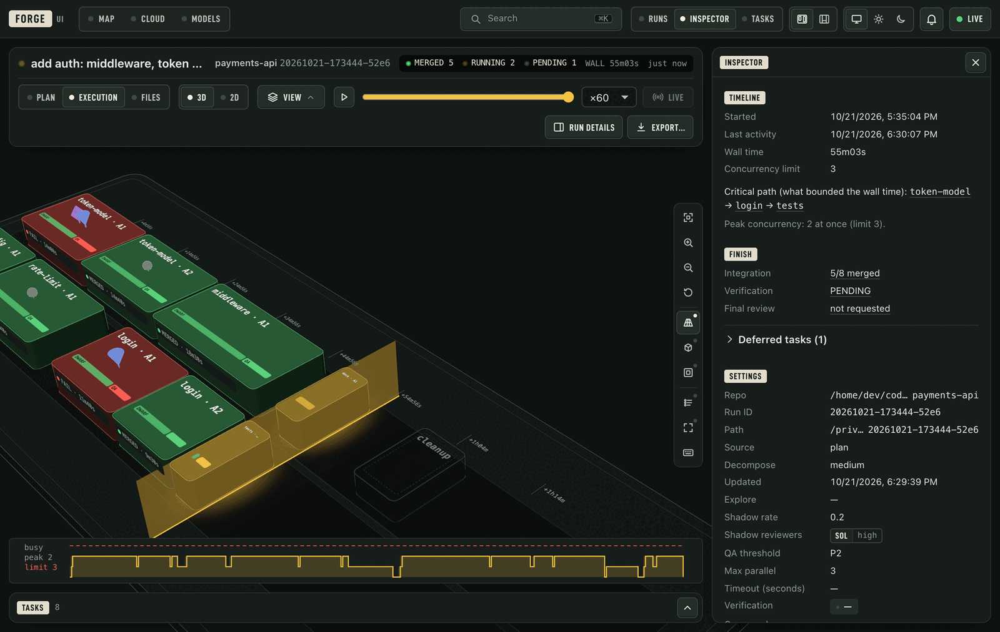
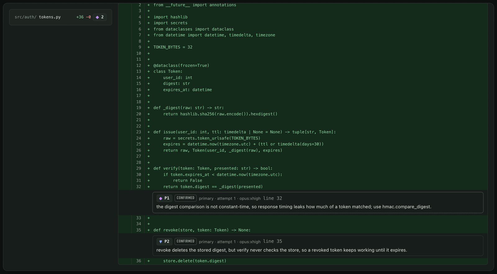
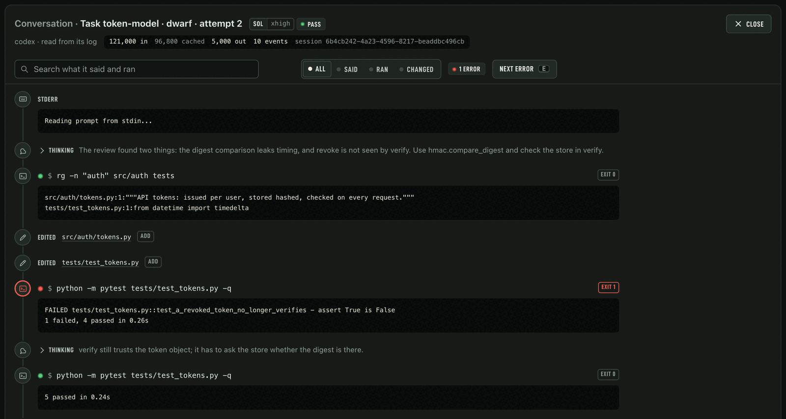
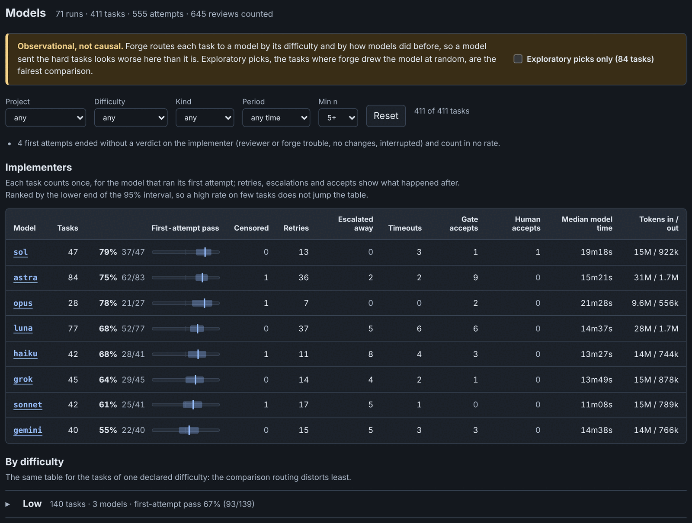
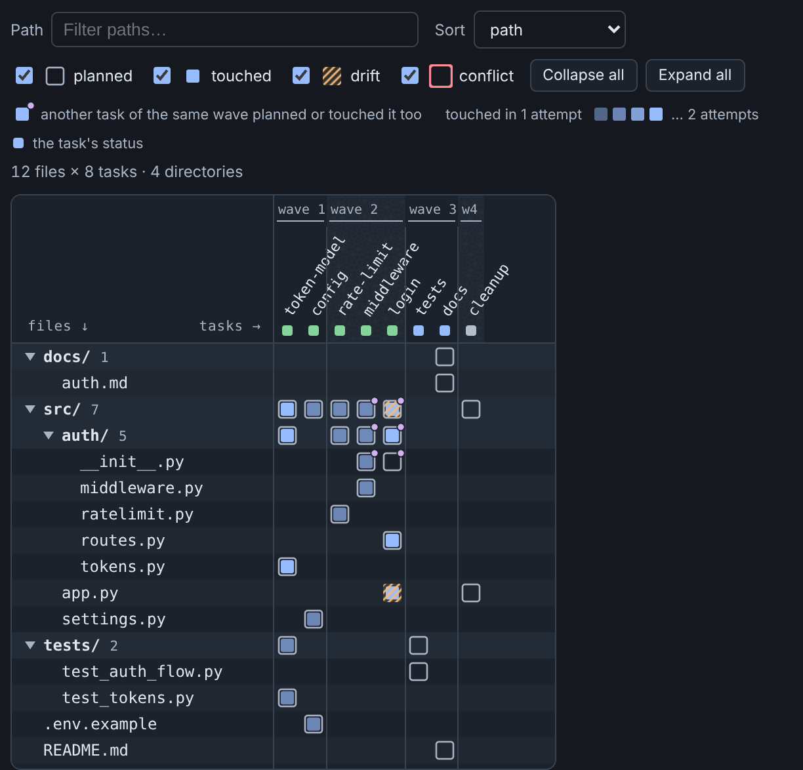
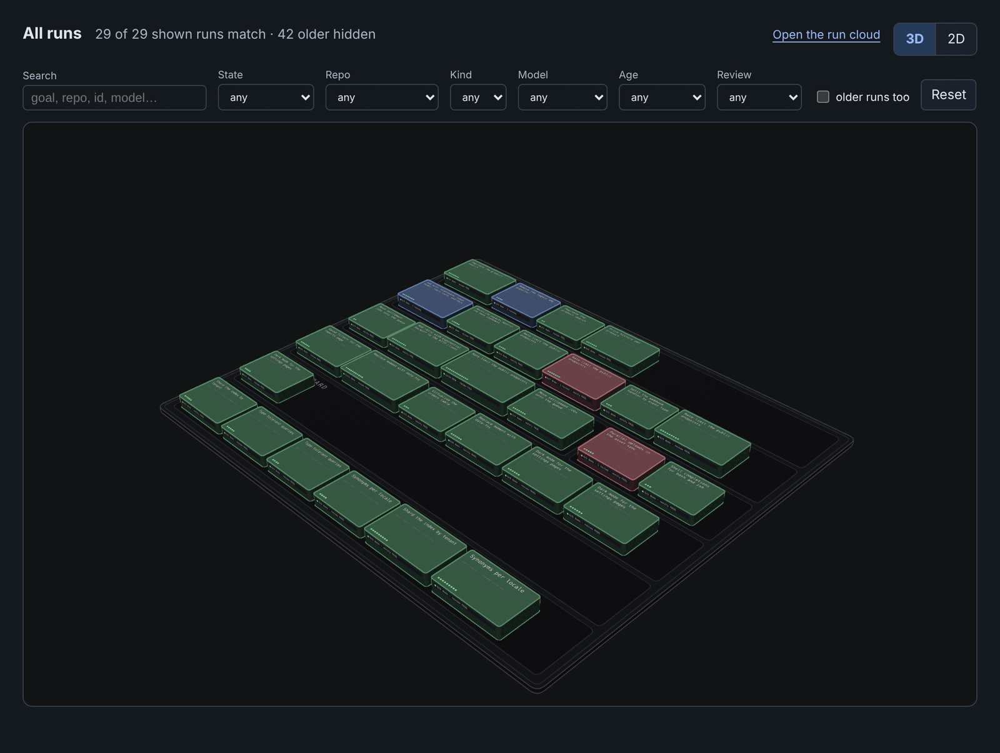

# forge-ui

[← README](../README.md) · [All docs](README.md)

forge-ui is a small local web page that shows runs live and, when you ask, changes them, as a 3D isometric map
ported from [archivision](https://github.com/Giamme/archivision). Its **run cloud** puts every
run in one full-screen view, grouped by project, in five layouts (helix, sphere, galaxy,
timeline, constellation), filtered down to exactly the runs you want; drag any run anywhere
and the cloud remembers it.

<p align="center">
  
</p>

<table>
<tr>
<td width="50%" valign="top"><br><b>A run, as planned.</b> Tasks in their waves with dependency cables, ending in integration, verification and the final review. Click a task to open its attempts, dwarves and reviews.</td>
<td width="50%" valign="top"><br><b>And as it ran.</b> One block per attempt in the lane it ran in, failed ones in red, against <code>--max-parallel</code>; the inspector names the critical path.</td>
</tr>
<tr>
<td valign="top"><br><b>Findings on their lines.</b> Any diff of a task, or exactly the diff one reviewer read, with each P0–P3 finding under the line it names.</td>
<td valign="top"><br><b>What each agent said and ran.</b> A dwarf's or reviewer's conversation from its CLI's log: commands with their exit and output, edits linked to the diff, its thinking; searchable, errors one key apart, live while it runs.</td>
</tr>
<tr>
<td valign="top"><br><b>Models, measured on your runs.</b> First-attempt pass rate with a confidence interval, retries, escalations, time and tokens; reviewers' verdicts and shadow agreement.</td>
<td valign="top"><br><b>Who touched which file.</b> Planned, changed, drifted into or conflicted on, wave by wave; a cell opens that file's diff.</td>
</tr>
<tr>
<td colspan="2" valign="top" align="center"><br><b>Every run, by repo.</b> One block per run with a lamp per task, filtered by state, repo, model, age or review verdict.</td>
</tr>
</table>

The page reads like a signal box's desk: engraved plates for headings, push buttons with lamps
for switches, and lamps that keep one meaning everywhere (amber running, green merged, red failed,
unlit pending). Two layouts share it. *Immersive*, the default, floats the runs, the inspector and the tasks
over a full-window stage (on a first visit the inspector and the tasks start folded, so a run
opens on its plate); *Workbench* docks them beside it with splitters. `1`, `2` and
`3` fold each module away, the header switches layout and theme (system, light or dark), and the
task and model tables sort, reorder and hide columns. forge-ui remembers all of it in your browser.

On the 3D stage every review finding stands over its block as a mark shaped by its severity, and
a click opens the diff at that finding. A chosen task keeps its route lit, a hover shows its card
(attempts, time, tokens, worst finding), and merges, failed attempts and escalations play over the
plate as they happen or as a replay passes them. The *View* menu switches each part of the drawing
on or off; the keys at the stage's edge fit, zoom, switch between perspective, isometric and
top-down, open a legend of what is drawn, and `?` lists every key.

Each dwarf's and reviewer's conversation opens from its attempt: what it said, what it ran and
with what exit, what it changed (with a link into the diff), its thinking folded, and the final
answer with tokens and cost, searchable, with its errors one key apart and, while it runs,
following its log as it grows. It is read from the agent CLI's own log, whichever harness
wrote it (as plain text for those that log no events yet), or for an older claude run from
Claude's session file on this machine.

### Controls

forge-ui reads everything, and it changes things only by calling forge's own commands: it
never writes a run file, a repo or a config itself. That keeps one set of rules (validation,
locks, the audit log) whichever way you change something, and a change from the page is
indistinguishable from the same command typed in a terminal, except that `control.log` says
`ui` instead of `cli`. Every change asks you to confirm and says when it takes effect.

- **Run controls** (a plan's inspector): the QA threshold, the per-attempt timeout, how many
  failures before escalating, verification retries, and, while a scheduler is live, the retry
  and infrastructure-retry budgets. A task has its own panel for a threshold override
  (including *None*, which exempts it from the run's threshold), its own retry budget, and a
  **model pin**: the model its next full retry uses, once. Each is `forge control`; see
  [decomposed runs](decomposed-runs.md#changing-a-run-while-it-works). A control that cannot
  apply (a budget with no live scheduler, a merged task) is disabled and says why.
- **Open findings:** the review findings a run left open (tolerated by `--qa-threshold`,
  PLAUSIBLE, or left by the whole-run review), for this run or every run of its repository.
  Select some and file them as GitHub issues, or dismiss the ones that need no work (and take
  that back). It runs `forge issues`, so a finding is never filed twice.
- **Delete a run:** a dialog that first shows a dry run, then deletes the run directory
  through `forge runs rm`. The dataset keeps the run's traces, and by default a `.tar.gz` of
  them too; you can also remove its clean worktrees and its branches that nothing has checked
  out. Anything that is not the run's own, or has uncommitted changes, is listed and left alone.
- **Settings:** every config source in one view (`forge config show`) and edits for the
  per-repo ones (`repo.verify`, `repo.setup`, `repo.verify-subset`, and Jev on or off). The
  registry stays read-only: the skill directory is often a live symlink to a checkout.

Writing is protected, because anything that can reach the server could otherwise change your
runs. The server makes a random token each time it starts and puts it in the page it serves;
the page sends it with every change, and the server also checks the `Host` and `Origin`
headers, so another website open in your browser cannot make your browser change a run. Reading
needs no token. `--read-only` (or `FORGE_UI_READONLY=1`) turns writing off altogether: no
token is issued and every change is refused. `FORGE_UI_READONLY=1 forge ui open` starts such a
server, and the launcher never reuses a server running in the other mode; it replaces it.

Also: replay, critical path, Fractal child-task trees, quick jump (Ctrl K, ⌘K on a Mac, or
`/`), a bell for runs that finish or fail, failed tasks and final-review verdicts (with opt-in
browser notifications), and a run exported as one HTML file that opens without forge-ui, with
prompts, diffs and local paths left out unless you choose them.

Offline (it loads three.js from a CDN for the 3D view) the same page works in 2D. It is opt-in.
The `/forge` skill asks "Open forge-ui to watch this run? [y/N]" at the start of every new
interactive run, or you pass it yourself:

```sh
bash scripts/forge-solo.sh "$RUN" --repo "$REPO" --dwarf sol --ui
bash scripts/forge-parallel.sh plan "$PLAN" --repo "$REPO" --decompose-level medium --ui
forge ui open [DIR]     # an existing run dir, or the run list
```

All runs share one detached server on `127.0.0.1:8765` (`FORGE_UI_PORT`) that exits after
four idle hours (`FORGE_UI_IDLE_S`). A UI that cannot start never fails the run. Reading needs
no token: any local process can read the prompts and diffs of the runs it shows; only changes
need the token (see [Controls](#controls)). See
[references/ui.md](../references/ui.md) and [ui/README.md](../ui/README.md).

To look around before your first run, point it at made-up runs (the ones in these pictures), from a git checkout:

```sh
python3 ui/tools/demo_runs.py /tmp/forge-demo
(cd ui && python3 -m forge_ui --no-registry --root /tmp/forge-demo --open)
```

## `forge ui` command group

| Command | Purpose |
| --- | --- |
| `open [DIR] [--no-browser] [--port N]` | start or reuse the shared forge-ui server (never one in the other mode); print `forge-ui: <url>` for the plan or solo run dir `DIR` (the run list without it) and open a browser the first time (a later `open` of the same run says on stderr that it opened none) |
| `status [--json]` | exit 0 and describe the server (and whether it is read-only) when it runs, 1 when not |
| `stop` | stop the server |

`FORGE_UI=off` makes `--ui` on a runner start nothing (it does not stop a running server or block `forge ui open`; use `forge ui stop`), `FORGE_UI_BROWSER=off` never opens a browser,
`FORGE_UI_PORT` (8765) and `FORGE_UI_IDLE_S` (14400, `0` = never) tune the server, and `FORGE_UI_READONLY=1` starts it read-only. State and
`server.log` are in `${XDG_STATE_HOME:-~/.local/state}/forge/ui/`.
