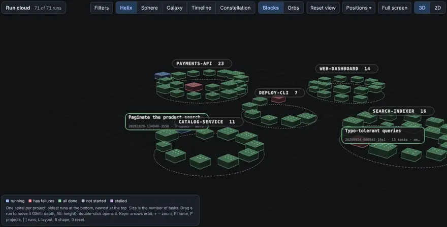
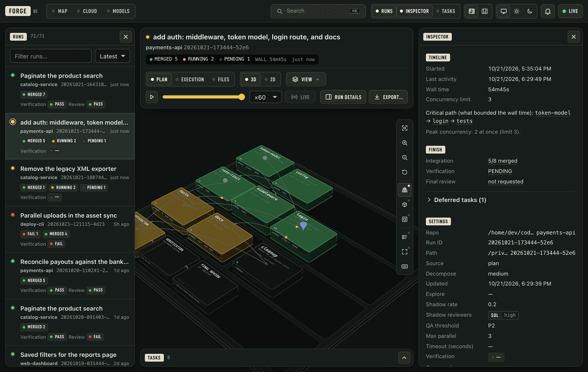
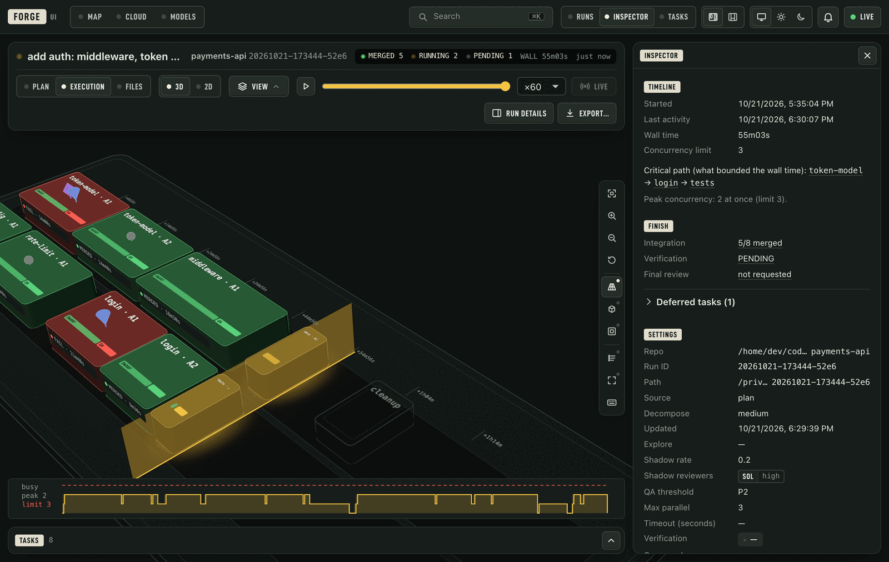
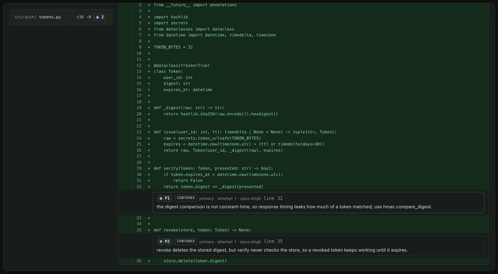
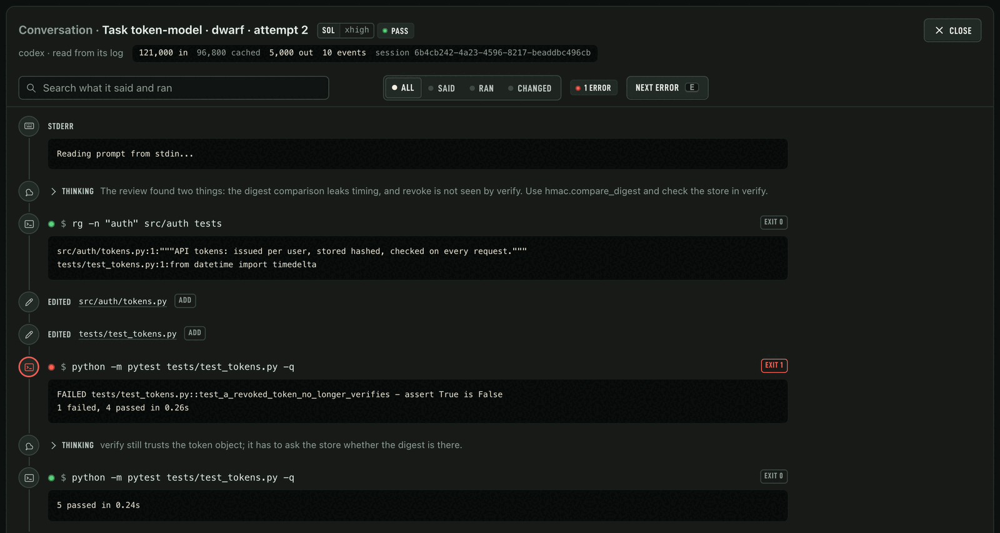
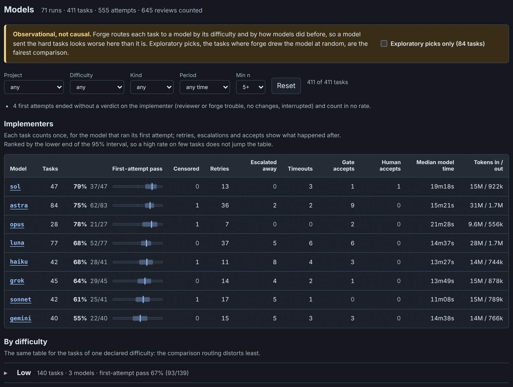
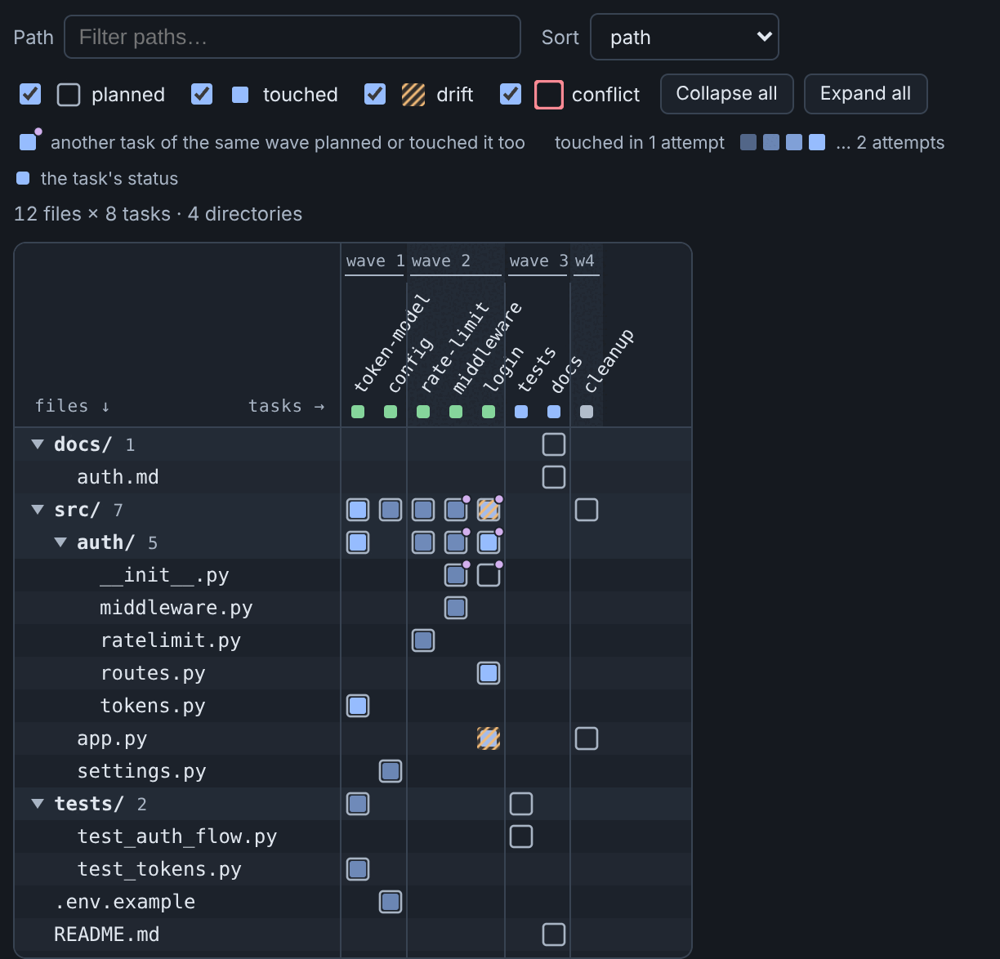
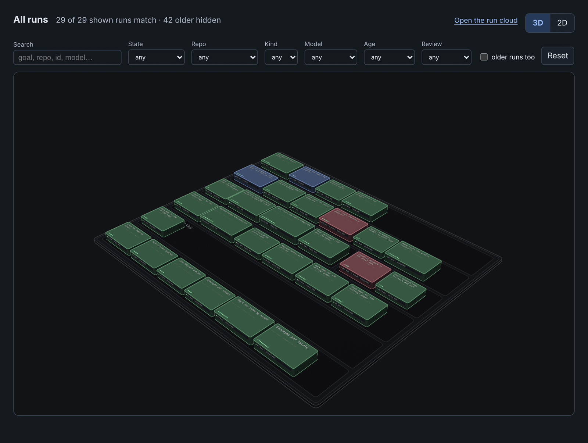

# forge-ui

[← README](../README.md) · [All docs](README.md)

forge-ui is a small local web page that shows runs live and, when you ask, changes them, as a 3D isometric map
ported from [archivision](https://github.com/Giamme/archivision). Its **run cloud** puts every
run in one full-screen view, grouped by project, in five layouts (helix, sphere, galaxy,
timeline, constellation), filtered down to exactly the runs you want; drag any run anywhere
and the cloud remembers it.

Runs are grouped by repository. A run started in any worktree of a repository shares that
repository's group, and each run shows the worktree and branch it started in.

<p align="center">
  
</p>

<table>
<tr>
<td width="50%" valign="top"><br><b>A run, as planned.</b> Tasks in their waves with dependency cables, ending in integration, verification and the final review. Click a task to open its attempts, dwarves and reviews.</td>
<td width="50%" valign="top"><br><b>And as it ran.</b> One block per attempt in the lane it ran in, failed ones in red, against <code>--max-parallel</code>; the inspector names the critical path.</td>
</tr>
<tr>
<td valign="top"><br><b>Findings on their lines.</b> Any diff of a task, or exactly the diff one reviewer read, with each P0–P3 finding under the line it names.</td>
<td valign="top"><br><b>What each agent said and ran.</b> A dwarf's or reviewer's conversation from its CLI's log: commands with their exit and output, edits linked to the diff, its thinking; searchable, errors one key apart, live while it runs.</td>
</tr>
<tr>
<td valign="top"><br><b>Models, measured on your runs.</b> First-attempt pass rate with a confidence interval, retries, escalations, time and tokens; reviewers' verdicts and shadow agreement.</td>
<td valign="top"><br><b>Who touched which file.</b> Planned, changed, drifted into or conflicted on, wave by wave; a cell opens that file's diff.</td>
</tr>
<tr>
<td colspan="2" valign="top" align="center"><br><b>Every run, by repo.</b> One block per run with a lamp per task, filtered by state, repo, model, age or review verdict.</td>
</tr>
</table>

The page reads like a signal box's desk: engraved plates for headings, push buttons with lamps
for switches, and lamps that keep one meaning everywhere (amber running, green merged, red failed,
unlit pending). Tasks merged with `accept` show as accepted (hollow green) rather than failed.
A final review superseded by tasks merged into the integration branch shows as OUTDATED
(hollow unlit) instead of as the run's verdict; changes on the user's own branch after an
integrate are not tracked. Two layouts share it. *Immersive*, the default, floats the runs, the inspector and the tasks
over a full-window stage (on a first visit the inspector and the tasks start folded, so a run
opens on its plate); *Workbench* docks them beside it with splitters. `1`, `2` and
`3` fold each module away, the header switches layout and theme (system, light or dark), and the
task and model tables sort, reorder and hide columns. forge-ui remembers all of it in your browser.

On the 3D stage every review finding stands over its block as a mark shaped by its severity, and
a click opens the diff at that finding. A chosen task keeps its route lit, a hover shows its card
(attempts, time, tokens, worst finding), and merges, failed attempts and escalations play over the
plate as they happen or as a replay passes them. The *View* menu switches each part of the drawing
on or off; the keys at the stage's edge fit, zoom, switch between perspective, isometric and
top-down, open a legend of what is drawn, and `?` lists every key.

Each dwarf's and reviewer's conversation opens from its attempt: what it said, what it ran and
with what exit, what it changed (with a link into the diff), its thinking folded, and the final
answer with tokens and cost, searchable, with its errors one key apart and, while it runs,
following its log as it grows. It is read from the agent CLI's own log, whichever harness
wrote it (as plain text for those that log no events yet), or for an older claude run from
Claude's session file on this machine.

The *Verification* node opens the run's verification in the inspector. While it runs you see
for how long, the step a lane announced (`::forge step`, see
[verification lanes](../references/decompose-integration.md#execution-checks-and-integration-verification))
and its last printed line, a warning after five minutes with no output, and the live output of
the lane that printed last (or of the one you choose). Once it fails, the failing tests come
first, by lane and marked new or known (from the lanes' JUnit or TAP reports), each with its
message, an excerpt and a link that opens the lane's log at that line; a lane without reports
shows the end of its log and the step it ended in. Below, every lane with its state (flaky and
known called out), time, runs and test counts; a lane's name opens its output. A single verify
command shows the newest of its logs. On the *Execution*
view the verification has rows of its own after the tasks, one per lane with a bar per run and
reruns marked (a single command's runs sit back to back, dashed, because only their durations
are known), and its finish node counts the lanes and reruns.

The task table's *Now* column, and *Now* at the top of a task's inspector, say where each task
is. A running task names the dwarf or reviewer at work, the command it is running (and whether
it is a test, type check, lint or build) and for how long, and flags *quiet N min* once its log
has said nothing for five minutes. A task that is not running says why: the tasks it waits on, a
running task it shares files with, no free slot, a drain or stop, an infrastructure pause with
its countdown, or the retry policy's stop with the split it proposes. The run's inspector says
what the scheduler is doing and how many tasks wait on what.

A run whose scheduler died (a crash, a killed terminal) reads as stopped: the tasks it left running
show as `INTERRUPTED`, *stopped: no live scheduler*, with `forge handoff resume <plan>` to pick it
up; the clock stops, Projects no longer counts the run as live and its worktrees are no longer in use.

A run with `groups.tsv` shows a Groups block after the task table. Each row is the group's title
and goal, "one review" or "per-task review", its reviewer and its members. A review group's
title opens `#/runs/<key>/group/<gid>`, and that row also shows the status, the round and who
the last review implicated. The group page shows a decision only while the group is
`NEEDS_DECISION`: the first line of `decision.md`, and a `forge group retry` command to copy.
The page does not run it. Below that are the findings, with ambiguous ones marked, the rounds,
known issues, the review text and a link to its transcript. A task at `IMPLEMENTED` reads
"awaiting group review" in the Status column and in its inspector. The lamp class stays
`IMPLEMENTED`. The task table adds a Group column while the run has groups, and the inspector
shows a `group <id>` chip. See [the forge-ui reference](../references/ui.md).

A task's inspector opens on its header: its title and goal, its links (`#N` and GitHub issue and pull
request URLs; `#N` links to the repo's GitHub origin when there is one), and the Prompt, Approach and
Acceptance criteria buttons. Then comes its attempt trail, one line per attempt with the reason it ran
(for example *after review findings* or *escalated to a stronger model*). Then its Summary: the
generated summary, the model and time it was made, its sources, and an *Out of date* mark once the
task has changed since. Then its Questions: the brief questions, each with an answer box. When a
question belongs to a group, or one is plan-scoped, the list is split: each group's title and
goal, then a Plan heading, then No group for a question with no group. A list with neither stays
flat. Parked questions stay behind a collapsed *Parked (wider scope)* block, grouped
the same way. An answered parked `wave` or `plan` question has *Propose a change*. A solo run has
the header and the trail only. Above a plan's task table sit its open brief questions, flagged
first and then by projected start, in those same groups, and under them the proposals. Each
proposal shows its state, scope, group, summary, diff and hash. One in state `proposed` has
*Approve* and *Reject*; the reject reason is optional. A task an approved proposal marked carries
an affected badge beside its status and in its inspector: `affected by <pid>`, or `flagged:
already started` when the task had already started. The marker's reason (`changed`, `added` or
`dependent`) is the badge's tooltip. The summaries switch sits with that list.
A run with a retro report or notes shows a Retro section in its run details: the note counts on one line,
then the report, collapsed.
A run someone drove with `forge handoff` shows a Handoff section there too: the driver (harness,
session, since when, last seen, and *stale* once it is over 12 hours old, when another session may
claim the run), then the session notes, newest first.

A task that stopped `NEEDS_INPUT` opens *Waiting for you*: the question from `tasks/<id>/needs_input.md`,
and a `forge-parallel.sh retry … --answer` command to copy. On a plan, when the server can write, an
answer field sits under that command. *Send answer* runs
[`forge control retry PLAN ID --answer-file -`](commands.md#the-forge-command) (`--actor ui`) and does
not ask first: it is not a destructive change. While a scheduler is live the page says the answer is
queued and the scheduler resumes the task; with no live run it says the answer is prepared for the
next `run`. A solo run shows the question and the command only. Under `--read-only` the field is
absent and the copy button stays.

Under each attempt's dwarf and reviewer are the checks they ran, read from their logs: each
test, type check, lint or build with its exit, its time and the counts it printed, a failed
one's last lines, and a link to that command in the conversation. Each attempt then says which
of the commands its brief's `## Acceptance criteria` names ran, ran another way, or never ran.
When a failed command met an environment problem (Docker down or out of address pools, a port in
use, the sandbox's EPERM, a refused local service, no network, a full disk, a missing command)
the attempt says so, and when more than one task met the same one, a banner in the run's header
lists them. codex and grok log no times, so forge keeps a small clock beside each agent's log
(`<role>.clock`, off with `FORGE_LOG_CLOCK=off`); runs from before it show their checks without
times.

A run with a [finding sweep](reviews.md#fixing-them-in-the-run-the-finding-sweep-opt-in) shows its fix
tasks like any other. A fix task's inspector lists the findings it took, each with a lamp for what
its review said (fixed, not fixed, not reported), and links each to the task it came from. That task
shows which of its findings the sweep took and where they stand. The run's *Finish* says how many
the sweep fixed and lists what it left for `forge issues`, with each reason.

A review the reviewer passed but forge failed, because it listed a blocking CONFIRMED finding, shows a red `forge: FAIL (reviewer said PASS)` chip in the *Review findings* section.

A task that was [split into subtasks](decomposed-runs.md#splitting-a-task-into-subtasks) has a
*Decomposition* section: the decision (split, kept whole, or kept whole at a limit), who made it
(the planner, you, or the run with `--auto-split`) and its reason, then every subtask below it
as a tree, through every level. Each node shows its status, model, difficulty, attempts and
tokens (forge records tokens, not prices) and links to its diff; a node opens as a task of its
own, with its attempts, reviews and controls. The section says whether the subtasks' work is on
the task's branch yet, which subtasks the task is waiting for, and whether the split started
over from the task's base. Rest the pointer on a decision to read what it means. A task the
planner kept whole shows the reason it gave; a task nobody decided about shows nothing. The
run's details show the limits every split works within and how much of the run was split, and,
for a goal larger than one plan, which stage this plan is and the stages after it. A sub-plan is
not listed among the runs: it opens from its task, and links back to it.

### Controls

forge-ui reads everything, and it changes things only by calling forge's own commands: it
never writes a run file, a repo or a config itself. That keeps one set of rules (validation,
locks, the audit log) whichever way you change something, and a change from the page is
indistinguishable from the same command typed in a terminal, except that the page passes
`--actor ui` (`control.log` says `ui` instead of `cli` for a control change). A destructive change
shows a dry run and then asks: removing worktrees, forgetting memories, compacting disk and deleting
a run. A finding action (mark fixed, dismiss, reopen, mark to file, duplicate, tag, note or edit),
adding or editing a learning, starting a triage, and approving a triage proposal each ask you to
confirm first, with no dry run. A brief answer, a brief proposal, approving or rejecting a brief
proposal, rejecting a triage proposal, and *Send answer* on a task that is waiting go out when you
press the button, with no dry run. The HTTP shapes are in
[the API](../ui/docs/api.md); this page describes what you do.

- **Run controls** (a plan's inspector): the QA threshold (shown with its source, `P2 (default)`
  or `P1 (set)`); it accepts `P0`–`P3`, *Default* (drop the setting; P2) and *None* (P3, nothing
  tolerated), the per-attempt timeout, how many
  failures before escalating, the effort step, verification retries, the infrastructure backoff,
  and, while a scheduler is live, the retry and infrastructure-retry budgets and max parallel.
  A live run also gets **Drain** (start nothing new; *Resume* ends it), **Stop** (finish what
  runs, then end the run) and **Stop now** (interrupt the running tasks), and one line per
  infrastructure pause: the model or harness it holds, the class, its tasks, and a countdown to
  its next try, or *budget used up*. A task has its own panel for a threshold override
  (*Inherit*, or a level; *None* means P3 for that task), its own retry budget, a
  **model pin**: the model its next full retry uses, once, and, on a live run, **Retry now**
  for a task that stopped or failed, on the policy's choice or a model you name. A retry is
  queued; the panel says *queued*, then *applied* or *refused* with the scheduler's reason.
  Each is `forge control`; see [decomposed runs](decomposed-runs.md#changing-a-run-while-it-works).
  A control that cannot apply (a budget with no live scheduler, a merged task) is disabled and
  says why. A task waiting `NEEDS_INPUT` is not *Retry now*: its answer field is described above
  and runs `forge control retry --answer`.
- **Projects (`#/projects`):** one page per repository with its runs, every finding forge's reviews
  wrote about it (each attempt, final reviews, shadow reviews behind a toggle), and every memory forge
  keeps for it, whichever run or checkout they came from. Repeats across rounds are one row with a count.
  The status column is the one [`forge findings`](commands.md#forge-findings) prints. The record wins
  when it says `duplicate`, `dismissed`, `fixed`, `filed` or `to-file`. Otherwise a filed issue GitHub
  has closed is `fixed` and one still open is `filed`; unless the record reopened the finding, a swept
  one is `swept` and an old dismissal is `dismissed`. A shadow review is `shadow`, an unlabelled one
  (`UNSTATED`) is `unlabelled`, and a finding a later review of the same task got past is `superseded`
  (that does not say it was fixed). Anything else is `open`. The open count, on the project list and
  in the Findings filter named `open`, counts only `open` and `to-file`, so `shadow`, `unlabelled`,
  `superseded`, `swept`, `dismissed`, `duplicate`, `filed` and `fixed` are left out. The project list
  does not ask GitHub, so a filed or swept finding can still be in that number; the Findings tab asks
  and can count fewer. A `to-file` row keeps its draft. Each row shows its tags: the ones stored on
  the record, or, when none are stored, the default for its path (`tests`, `docs`, `infra`, `ui` or
  `backend`), marked as derived from the path. The tab asks `forge issues` online, so a closed issue
  can show `fixed`, and says when those states were read. When GitHub cannot be asked it says so, and
  that a filed finding may show as open. When the server can write, select findings (a row with no
  record key cannot) and confirm one action. There is no dry run. Each runs
  [`forge findings`](commands.md#forge-findings) on the repository root with `--actor ui`: *Mark fixed*
  is `forge findings fix REPO FP…` with `--commit` (7 to 40 hex characters), `--reason`, or both;
  *Dismiss* is `forge findings dismiss REPO FP… --reason TEXT` (the reason is required); *Reopen* is
  `forge findings reopen REPO FP…`; *Mark to file* is `forge findings to-file REPO FP…` with an
  optional `--title` and keeps a draft, it does not open a GitHub issue; *Duplicate of…* is
  `forge findings dup REPO FP --of FP` (one finding); *Tags…* is `forge findings tag REPO FP… -- TAG…`
  with `--add` or `--remove`. A row's *Note* is `forge findings note REPO FP TEXT` (empty text clears
  it) and *Edit* is `forge findings edit REPO FP` with `--severity` (`P0`–`P3`), `--text-file`, or
  both: the replacement stays on the record and does not rewrite the review. Note and edit take one
  finding. *File selected* is separate and still runs `forge issues`: it shows the drafts and creates
  the GitHub issues only after that confirm. *Triage with an agent* is on the same tab. You name a
  spec; the page checks it with `bash scripts/forge-dispatch.sh doctor --spec S --role side` and does
  not call a model for that check. *Start triage* stays disabled until that check passes, while a
  triage is already running, or when *Most findings* is filled in with anything other than a whole
  number from 1 to 2000. Starting
  asks you to confirm, because it spends that model's quota, then runs
  `forge findings triage REPO --spec S [--max-findings N] --detach --actor ui`. Left empty, *Most
  findings* omits `--max-findings` and the command's default of 400 applies. While it runs, the page reads
  `forge findings triage-status` and `forge findings proposals` every 5 seconds. The agent only
  proposes. Each proposal is `duplicate`, `fixed`, `tag`, `issue` or `plan`. *Approve* asks first and
  runs `forge findings apply REPO N PID --approve HASH [--plan-dir DIR] --actor ui` with the hash on
  that card, so a proposal that changed since you read it is refused and nothing is written. An
  `issue` approval only marks those findings `to-file` with the draft; GitHub is not contacted. A
  `plan` approval writes a plan directory and shows
  `bash scripts/forge-parallel.sh plan DIR --repo CHECKOUT`. Nothing runs by itself. *Reject* runs
  `forge findings reject REPO N PID [--reason TEXT] --actor ui` when you press it, with no confirm.
  Under `--read-only` the tab still lists the findings and shows those `forge findings` commands to
  copy, including the triage ones, and hides the buttons. The Memories tab shows what `memory.md`
  gives each role and each learning's state, as `forge memory learnings` reports it. Runs and
  checkouts that are gone are read from the dataset, and those rows say so. When the server can write,
  each learning on the checkout you are looking at has a checkbox, the filtered list has *Select all*,
  and *Forget selected* runs [`forge memory forget`](commands.md#forge-memory-forget) on that checkout
  with `--actor ui`. It dry-runs first. The confirm lists the learnings (`category:key` and the text)
  and the `memory.md` lines that go, or says that no `memory.md` line goes. Cancelling sends nothing
  more. The result then says how many ledger rows each key lost, or that the key was not found. A
  learning with no category or key cannot be selected. *Add learning* runs `forge memory add` on the
  checkout you picked, or on every checkout of the project that exists when none is picked:
  `--category verify|trap|finding --text TEXT [--path P]… --actor ui`. *Edit* on a row runs
  `forge memory edit` there with that learning's `category:key` and `--text`, the same `--actor ui`.
  Each asks you to confirm first, with no dry run; the confirm names the checkouts and, for an edit,
  the old text and the new. Add and edit are documented with
  [`forge memory forget`](commands.md#forge-memory-forget). Under `--read-only` the tab still shows
  the learnings, hides the checkboxes, Forget, Add and Edit, and gives each row a *Commands*
  button that shows its `forge memory edit` and `add` commands to copy, one row at a time. Reachable from the header, a run's repository name and each map district.
- **Disk (`#/disk`):** what forge takes on disk in every repository it has runs for (each run dir's
  review snapshots, logs and anything forge does not create, each run's worktree folder, the data home),
  what can go without losing a run, and the command that takes it back (`forge runs compact --logs`),
  to copy. The same report as `forge du --all`; measured in the background when the screen opens.
  When the server can write, a reclaimable run gets *Compact* and the whole-disk command gets
  *Compact all*. Each one dry-runs
  [`forge runs compact`](commands.md#forge-runs-compact) `--logs` first and the confirm says how
  much space would be freed and across how many runs. The real call is the same command without
  `--dry-run`. An active run is refused and the page says to compact it after it ends. Copy stays
  beside the button. Under `--read-only` the commands are only copied. This command records
  `run_compacted` and takes no actor.
- **Worktrees (`#/worktrees`):** every worktree forge created, in any repository it knows: its
  run, task, branch, last commit, size and status (in use, uncommitted changes, locked, needed by
  the run, failed task, finished, missing on disk, not forge's, unknown to git, removed), and the
  command that removes it safely, to copy. Those copied commands never use `--force` (`git worktree
  remove`, `git branch -d` for a finished merged branch, `rm -rf` for a leftover folder, `git status`
  or `git worktree prune` when that is the safe next step). The per-run `forge runs rm … --dry-run`
  line is still only copied: it would delete the run directory as well. When the server can write,
  the filtered view adds a checkbox and *Remove* on each row that can go, *Select all* for those
  rows, *Remove selected*, and *Delete merged branches too*. *Remove* and *Remove selected* both
  run [`forge worktrees rm`](commands.md#forge-worktrees-rm) with `--actor ui` (and `--branches`
  when that box is checked): one dry run, a summary of what would go and what is skipped and why,
  then a confirm, then the real call and a line per row (removed, skipped, or failed, with the
  reason). If the dry run would remove nothing, that summary is the end of it and nothing is
  asked. A row that cannot be removed shows why beside a disabled checkbox (its run is active,
  uncommitted changes, locked by git, the run still needs it, already gone, not forge's, already
  removed, or not a leftover). Under `--read-only` there is no checkbox and no Remove, and every
  copy button stays. Removed worktrees are listed from the dataset (`worktree_created` and
  `worktree_removed` events); worktrees from before forge recorded them are derived from run dirs,
  without dates. With `FORGE_DATASET=off` the screen lists only what git and the run dirs say.
- **Open findings:** the review findings a run left open (tolerated by `--qa-threshold`,
  PLAUSIBLE, or left by the whole-run review), for this run or every run of its repository.
  Findings of an outdated review carry an "outdated review" marker, findings a person
  accepted have origin `accepted`, and findings the run's finding sweep fixed are *swept*: listed,
  never filed. Select some and file them as GitHub issues, or dismiss the
  ones that need no work (and take that back). It runs `forge issues`, so a finding is never
  filed twice.
- **Delete a run:** a dialog that first shows a dry run, then deletes the run directory
  through `forge runs rm`. The dataset keeps the run's traces, and by default a `.tar.gz` of
  them too; you can also remove its clean worktrees and its branches that nothing has checked
  out. Anything that is not the run's own, or has uncommitted changes, is listed and left alone.
- **Settings:** every config source in one view (`forge config show`) and edits for the
  per-repo ones (`repo.verify`, `repo.setup`, `repo.verify-subset`, and Jev on or off). The
  registry stays read-only: the skill directory is often a live symlink to a checkout. You pick
  the repository through one of its runs, from a list grouped by repository that shows each
  run's worktree and branch (arrow keys and typing work in it), and the page names the
  directory the configuration was read from.
- **Summaries:** a switch above a plan's task table turns summaries on or off for the run. A task's own
  switch, in its Summary section, sets it to *On*, *Off* or *Inherit* (the run's setting). Each change is
  confirmed first. Turning them on for a finished run starts `forge summarize` in the background.
  Beside the run's switch, the model they use (or *no model set*) and a field that sets the run's own
  (`forge control set summaries-model`): a planned run never reads `forge config set summaries.model`
  again, and *On* is refused, with that reason, while the run has no model.
- **Message for the next attempt:** a task that has not merged has a box that queues a message for its
  next implementer attempt (`forge control steer`), and lists the ones waiting. It starts nothing. An
  attempt that got messages has a *steered* mark on its line of the attempt trail. While the task's
  claude or openclaude implementer runs live, the box also has *Send now* (`forge control steer
  --now`), which gives it the message at its next tool call, and the conversation shows each message
  sent that way where the implementer took it in (*Your message*, *sent live*).
- **Brief answers and proposals:** each brief question in a task's inspector has an answer box, and *Send* records the
  answer (`forge brief answer`, logged as `ui`). A late answer, given after the task started, shows the
  CLI's notice under its question. An answered parked `wave` or `plan` question has *Propose a change*
  (`forge brief propose`, logged as `ui`). A proposal in state `proposed` has *Approve*
  (`forge brief apply PLAN PID --approve HASH --actor ui`, using the hash on the card) and *Reject*
  (`forge brief reject`, with an optional reason, logged as `ui`). Answers, proposals, approvals and
  rejections are sent at once, without a confirm.

Writing is protected, because anything that can reach the server could otherwise change your
runs. The server makes a random token each time it starts and puts it in the page it serves;
the page sends it with every change, and the server also checks the `Host` and `Origin`
headers, so another website open in your browser cannot make your browser change a run. Reading
needs no token. `--read-only` (or `FORGE_UI_READONLY=1`) turns writing off altogether: no
token is issued and every change is refused. No action button is shown: not the run controls,
not Remove or Forget selected or Compact, not the finding actions, Add learning, Edit or triage
Start, Approve and Reject, and not *Send answer*. The summaries and the questions still show,
without their switches, answer boxes, or Propose, Approve and Reject buttons, and every copy
button stays (worktree commands, compact commands, the `forge findings` and `forge memory`
commands, the triage commands, and the `retry --answer` command on a waiting task). `FORGE_UI_READONLY=1 forge ui open` starts such a
server, and the launcher never reuses a server running in the other mode; it replaces it.

Also: replay, critical path, the tree of a split task's subtasks, quick jump (Ctrl K, ⌘K on a Mac, or
`/`), a bell for runs that finish or fail, failed tasks and final-review verdicts (with opt-in
browser notifications), and a run exported as one HTML file that opens without forge-ui, with
prompts, diffs and local paths left out unless you choose them.

Offline (it loads three.js from a CDN for the 3D view) the same page works in 2D. It is opt-in.
The `/forge` skill asks "Open forge-ui to watch this run? [y/N]" at the start of every new
interactive run, or you pass it yourself:

```sh
bash scripts/forge-solo.sh "$RUN" --repo "$REPO" --dwarf sol --ui
bash scripts/forge-parallel.sh plan "$PLAN" --repo "$REPO" --decompose-level medium --ui
forge ui open [DIR]     # an existing run dir, or the run list
```

All runs share one detached server on `127.0.0.1:8765` (`FORGE_UI_PORT`) that exits after
four idle hours (`FORGE_UI_IDLE_S`). A UI that cannot start never fails the run. Reading needs
no token: any local process can read the prompts and diffs of the runs it shows; only changes
need the token (see [Controls](#controls)). See
[references/ui.md](../references/ui.md) and [ui/README.md](../ui/README.md).

To look around before your first run, point it at made-up runs (the ones in these pictures), from a git checkout:

```sh
python3 ui/tools/demo_runs.py /tmp/forge-demo
(cd ui && python3 -m forge_ui --no-registry --root /tmp/forge-demo --open)
```

## `forge ui` command group

| Command | Purpose |
| --- | --- |
| `open [DIR] [--no-browser] [--port N]` | start or reuse the shared forge-ui server (never one in the other mode); print `forge-ui: <url>` for the plan or solo run dir `DIR` (the run list without it) and open a browser the first time (a later `open` of the same run says on stderr that it opened none) |
| `status [--json]` | exit 0 and describe the server (and whether it is read-only) when it runs, 1 when not |
| `stop` | stop the server |

`FORGE_UI=off` makes `--ui` on a runner start nothing (it does not stop a running server or block `forge ui open`; use `forge ui stop`), `FORGE_UI_BROWSER=off` never opens a browser,
`FORGE_UI_PORT` (8765) and `FORGE_UI_IDLE_S` (14400, `0` = never) tune the server, and `FORGE_UI_READONLY=1` starts it read-only. State and
`server.log` are in `${XDG_STATE_HOME:-~/.local/state}/forge/ui/`.
