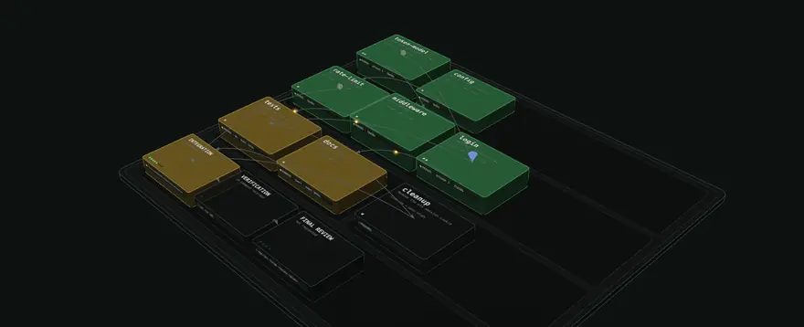

# forge-ui

forge-ui is a small local web UI for forge runs. It reads everything, and changes things only by
calling forge's own commands (see [Controls](#controls)). It draws them the way
[archivision](https://github.com/Giamme/archivision) draws a codebase: a 3D isometric map of
blocks on a plate, with cables between them and lamps that light up as things happen.

- **A map of every run**, one district per repo and one block per run, with a lamp per task.
  Filter it by state, repo, kind, model, age or review verdict; what does not match fades
  instead of disappearing.
- **A run, as planned and as it ran.** *Plan* puts each task in its planned wave, with
  dependency cables, and ends in a *finish* line of three nodes: integration, verification
  and the whole-run **final review**. *Execution* lays the same work out on wall-clock time:
  one block per attempt, in the lane it really ran in, with its dwarf and review inside, the
  attempts that have not started projected by forge-schedule's own rules, and a strip of how
  many slots were busy against `--max-parallel`. Switching between the two moves each task
  from its wave to where it ran.
- **Click to open.** A task opens to show its attempts, each with its dwarf, its reviewer and
  any shadow reviews, linked; an escalation is a labelled cable between attempts. The
  inspector beside the stage shows what launched each step and what came of it: the exact
  prompt, the model (alias, harness, model, effort, clamping), the timings by phase, tokens,
  the verdict, and every **P0–P3 finding** of every review, the final review included.
- **Live.** Statuses change in place while a run works (every 2 s while something runs, 5 s
  otherwise); running nodes pulse and show their current phase.
- **Extras:** replay a run from its recorded times, light its critical path, set block height
  and colour by duration, tokens, attempts or model, and mark shadow reviews that disagreed
  with the primary and how sure Clef was that each task would pass.
- **Beyond one run:** a full-screen **run cloud** of every run, grouped by project, in five
  layouts with filters and runs you can drag anywhere; **diffs** with each finding under the
  line it names; each dwarf's and reviewer's **conversation**, read from its CLI's log; a
  **model leaderboard**; a **files heatmap**; **Fractal** child-task trees;
  **quick jump** and **notifications**; and **export** of a run as one HTML file. See
  [What you see](#what-you-see).

<p align="center">
  
</p>

The 3D view loads three.js from a CDN the first time it is used (see [Privacy](#privacy)).
Without it (offline, an old browser, no WebGL) the same page shows the 2D dependency graph,
an execution chart and the same inspector. The server is Python's standard library; there
is no install or build step.

It lives inside forge, in `ui/`, and is forge's companion: runs open it with `--ui`.

## Run it

Normally forge launches it. `forge ui open [DIR]` (from the forge checkout) starts or
reuses one shared detached server and prints the link to a run dir, `forge ui status`
shows it and `forge ui stop` ends it; see [references/ui.md](../references/ui.md). A run
starts it itself with `forge-solo.sh --ui` or `forge-parallel.sh plan --ui`.

To run the server directly, from `ui/`:

```sh
python3 -m forge_ui
```

Open the printed URL (default `http://127.0.0.1:8765/`). Stop with Ctrl-C.

- `--plan DIR`: add one plan directory; repeatable, default none.
- `--root DIR`: scan for plan directories at depth 0–2; repeatable, default none.
- `--no-registry`: disable the registry, which is read by default.
- `--registry-dir DIR`: override the registry directory described below.
- `--port N`: use port N, default `8765`; `0` selects a free port.
- `--quiet`: suppress request logging; off by default (errors can still be logged).
- `--open`: open the browser after startup; off by default.
- `--idle-exit SECONDS`: exit after that many idle seconds; default `0` (never). `forge ui` sets it from `FORGE_UI_IDLE_S`.
- `--version`: print the version and exit.
- `-h`, `--help`: print usage and exit.

Three examples (replace the example paths with your own):

```sh
# Registry only
python3 -m forge_ui
# One plan directory only
python3 -m forge_ui --no-registry --plan /path/to/plan
# A root containing many runs, without registry entries
python3 -m forge_ui --no-registry --root /path/to/runs
```

No runs yet? `tools/demo_runs.py` writes made-up ones, the same that fill the pictures here: a
live run and a few weeks of history across five projects.

```sh
python3 tools/demo_runs.py /tmp/forge-demo
python3 -m forge_ui --no-registry --root /tmp/forge-demo --open
```

## Where runs come from

Sources are checked in this order:

1. Explicit `--plan DIR` directories.
2. `--root DIR` itself, its children and grandchildren. Scanning stops when a plan
   directory is found; hidden children and symlinked child directories are skipped.
3. Forge's registry: `*.txt` files in `$XDG_CONFIG_HOME/forge/runs/`, defaulting
   to `~/.config/forge/runs/` when XDG_CONFIG_HOME is unset, empty or relative. Each file
   supplies absolute paths, one per line; blank lines and `#` comments are ignored.
   `--registry-dir` replaces this location; `--no-registry` disables it.

Plan directories (containing a `tasks.tsv` file) and solo run directories (a `prompt.md`
and a `repo` file) appear through `--plan` and the registry; `--root` finds plan directories
only. Stale or invalid paths are skipped. Duplicate real paths appear once,
with the first source winning. Discovery and disk reads repeat on each API request.

## What you see

forge-ui looks like a signal box's route-setting desk: the run is drawn on a panel, every heading
is an engraved plate, every switch is a push button whose lamp lights when it is on, and lamps
keep one meaning everywhere (amber running, green merged or passed, red failed, unlit pending).

- **Layout:** the *Runs*, *Inspector* and *Tasks* modules sit around the stage. *Immersive* (the
  default) floats them over a stage that fills the window; *Workbench* docks them beside it, and
  the runs list folds to a rail of lamps. Switch with the two layout keys in the header; the
  module keys beside them, or `1`, `2` and `3`, fold and open the runs, the inspector and the
  tasks. On your first visit the inspector and the tasks start folded, so a run opens on its plate. Drag a module's inner edge, or focus it and use the arrow keys, to resize it. The header
  also switches the theme (system, light or dark). All of this is remembered in this browser.
- **Map (`#/`):** every discovered run, newest first, grouped by repo. By default the last
  60 runs from the past 14 days; *older runs too* shows the rest. The runs list follows the same
  filter, and sorts by latest activity, state or repo.

  
- **Run cloud (`#/cloud`):** every run at once, full screen, floating in 3D and grouped by project
  (repo). Pick a layout: *Helix* (one spiral per project, oldest at the bottom), *Sphere*,
  *Galaxy* (a disc per project, newest at the centre), *Timeline* (left to right by start time,
  one lane per project) or *Constellation* (pulled together by project and shared models, with
  lines joining each project's nearest runs). Runs are *Blocks* (a lamp per task on the roof) or
  *Orbs* (a ring of task segments); size is the number of tasks, colour the run's state. The
  filter panel narrows the cloud to exactly the runs wanted: projects, state, kind, difficulty
  (has a task of, or mostly), tasks per run, models (any role, implementer or reviewer), recent
  activity, final review, verification, decompose level and text (goals, ids, task titles).
  Orbit, pan and zoom anywhere; drag a run to put it where you want (Shift: nearer or further,
  Alt: up or down). Dropped positions are kept in this browser per layout; *Positions* resets them
  (with undo) or exports and imports them as a JSON file. Click a run for its card, double-click
  to open it; `#/cloud/runs/<key>` and `#/cloud/projects/<id>` link to a selection. Keys:
  arrows orbit, + − zoom, F frames, P steps through projects, [ ] through runs, L changes the
  layout, B the shape, 0 resets the view, Esc steps back. With *2D*, the cloud lists the same
  filtered runs and offers *Load 3D*.

  
- **Run (`#/runs/<key>`):** a header with the goal, the repo, a describer (each state's count,
  the wall time, how long since anything moved), a bank of push buttons (*Plan* /
  *Execution* / *Files*, *3D* / *2D*, and *View*: height and colour overlays, the *Layers* that
  switch each part of the 3D drawing on or off, and the *Marks*: *Critical path*, *Review marks*,
  *Projected*) and the replay's time base; then the stage, the inspector and the
  task table. The stage frames the run in the part of the window the modules leave free. The
  inspector opens when you choose a task, an attempt or a finish node; with
  nothing chosen it shows the run's timeline, finish and record (*Run details* in the header:
  settings, request, waves, verification output).
- **Stage (3D):** each review finding stands over its task's block as a mark shaped by its
  severity (P0 spike, P1 diamond, P2 cone, P3 pin, a ring when it has none; a plausible one smaller
  and paler); on an opened task it moves onto the review that raised it, and the final review's sit
  on *Final review*. Hover one for its location and summary; click it to open the diff that
  review read at that finding. Choosing a task keeps its route lit, what it waits on and what
  waits on it (`I` switches this off). Hovering a task shows its card: status, attempts, busy
  time, tokens, models, its worst finding and what waits on it. A block whose roof text is too
  small to read gets its name on a tag that faces you. A merge sends a pulse to *Integration*, a
  failed attempt a red ring across the plate, an escalation a hop with the two models, a final
  review a ring in its verdict's colour, live and during a replay (with reduced motion the block
  lights instead). The keys at the stage's edge fit what is shown (`F`), zoom (`+` `−`), change
  the projection (`V`: perspective, true isometric, top-down), reset the view (`0`), open the
  legend of what the stage draws now (`L`), go full screen, and list every key (`?`). The layers,
  the projection and the route are remembered.
- **Lamps:** green merged or passed, amber running, red failed, unlit pending. A hollow lamp is
  that family's other case: passed or accepted without a merge (green), interrupted (amber), an
  infrastructure failure, a timeout or blocked behind a failure (red). Review findings are never
  a lamp: their severity is a shape (P0 spike, P1 diamond, P2 cone, P3 pin).
- **Tables:** the task table and the leaderboard's tables sort by any column (click its header:
  ascending, descending, off), reorder by dragging a header (or Alt+← → on it), and show or hide
  columns from *Columns*, which also resets them. Each table remembers its columns.

   
- **Inspector:** for the run, its timeline, critical path, peak concurrency and finish line;
  for a task, its models and routing, escalations, timings (busy, model time, overhead,
  queue wait after its dependencies merged), attempts and their executions, review findings
  with the gate decision, Clef predictions against outcomes, and its prompts; for one
  execution, its model, phases, tokens, exact prompt and final message; for the final
  review, its verdict, findings, report, prompt and history.
- **Files (the run toolbar's third mode):** a heatmap of files (grouped and collapsible by
  directory) against tasks (grouped by wave): planned files outlined, touched files filled by how
  many attempts changed them, drift hatched, merge conflicts ringed, and a dot where another task
  of the same wave planned or touched the file too. Filter by path, sort by path, most touched or
  most tasks, and hide any kind of mark; a cell selects its task and offers that file's diff.
  Below: overlaps, drift, merge conflicts and deferrals as lists.

  
- **Models (`#/models`):** a leaderboard of the models forge used. Implementers: tasks, first-attempt
  pass rate with its 95% Wilson interval, censored attempts, retries, escalations away from the
  model, timeouts, gate and human accepts, median model time and tokens. Reviewers: primary,
  shadow and final reviews, the PASS/FAIL split, findings per review by severity, how often a
  shadow review agreed with the primary, and how often work it PASSed did not hold (later
  reverted or rewritten, from `forge dataset reviewers`; "not enough data" below 10 outcomes). Filter by project, difficulty, kind and period, or keep
  only exploratory picks; open a difficulty for its own table. Routing is not random, so the
  numbers compare what happened, not what would have: the page says so. A model's name opens the
  run cloud filtered to its runs.

  
- **Diffs (`…/tasks/<id>/diff[/<source>][/file/<path> | /finding/<id>]`, `…/final-review/<name>/diff[/finding/<id>]`):** a task's
  `changes.diff`, its previous or committed diff, or exactly the diff one reviewer read (the last
  diff in that review's prompt), picked from a row of sources with each review's verdict; a final
  review's combined diff. Files are listed with their +/− counts and how many findings point
  into them; each finding is shown under the line it names, those on a line outside the changed
  hunks at the top of their file, and those whose file is not in the diff (or that name no
  location) in a section of their own. n and p move between findings, j and k between files.
  Open it from a task, an attempt's review, an execution or the final review in the inspector, or
  from a finding's mark on the stage (`/finding/<id>` scrolls to that finding and focuses it).

  
- **Conversations (`…/tasks/<id>/executions/<dwarf-or-qa>/conversation`, `…/executions/<id>/conversation`):**
  what one dwarf or reviewer said and did, read from its agent CLI's `<role>.log`, in the diff's
  place: its messages, its thinking folded, each command with its exit and output, each edit with
  its patch and a link to the file in the diff its review read, other tool calls, and the final
  answer with the tokens and cost. Search it (`/`), keep only what it said, ran or changed, and
  step through its errors (`E`). While the agent works the log is read again every few seconds and
  *Follow* keeps the newest event in view. codex, grok, claude, openclaude and opencode logs are
  read event by event; when a claude run logged only its final answer, the conversation comes from
  Claude's own session file for that run, if it is still on this machine; any other log is shown
  as it is. Open it from an attempt's dwarf or reviewer in the inspector.

  
- **Fractal child tasks:** when a run used Fractal, a task's inspector shows the tree it was split
  into (status, difficulty, model, phase, cost, the split decision), and the opened task in 3D
  carries the same tree floating above it. A node (`…/tasks/<id>/fractal/<node>`) shows its goal,
  paths, timings, cost and tokens, its decomposition and the children it admitted, its last
  messages, and its candidate diff. Fractal's state is read under `$XDG_STATE_HOME/forge/fractal`
  (default `~/.local/state`), only read, without following symlinks.
- **Export:** *Export…* in a run's header downloads the run as one HTML file that opens in any
  browser without forge-ui, offline included (in 2D; in 3D when cdn.jsdelivr.net is reachable).
  It asks each time: by default prompts, reviewer reports, logs, finding details and diffs are
  left out (each finding's headline stays) and local paths are reduced to their last component.
  The file states what it left out, and fetches nothing but three.js: its own policy allows only
  its inline scripts, by hash.
- **Quick jump:** Ctrl K (⌘K on a Mac), `/` or *Search* opens one search over every run (goal,
  run id, repo, models), task (id and title), project, model and command. Enter opens the pick;
  Shift+Enter shows a run in the cloud; a model shows its runs in the cloud. With nothing typed,
  recent picks and running runs come first.
- **Notifications:** the bell lists what changed while the page was open: a run that finished or
  ended with failures, a task that failed (FAIL, ERROR, CONFLICT, TIMEOUT, INVALIDATED,
  INTERRUPTED or BLOCKED; INFRA retries are not failures) and a final review's verdict, each
  linked to it. Unread ones show as a count in the tab title and a dot on its icon. *Enable
  browser notifications* asks the browser once; then changes also show as system notifications
  while the tab is in the background, and a hidden tab checks the run list every 30 seconds
  (browsers may check less often after a while). Open tabs share one log and notify once. Runs
  that have not changed for two hours never notify.
- **Keys on the stage:** with the stage focused, ← → move between tasks (on the map, between
  runs; ↑ ↓ between repos, Enter opens the run), Esc closes, `e` switches plan and execution.
  Anywhere on the page while the stage shows: `F`, `+` `−`, `V`, `0`, `L`, `I`, Shift+F (full
  screen) and `?`. Drag to orbit, right-drag to pan, scroll to zoom once the stage is clicked.

URLs such as `http://127.0.0.1:8765/#/runs/<key>/tasks/<id>` are shareable within the
machine while this server is running and discovering that run dir. *Live refresh* pauses
polling; a hidden tab polls only the run list, every 30 seconds, and only with browser
notifications on. Failed requests keep the last good data and show a banner.

## Controls

The page can change a run, and every change is one call of a forge CLI; the server writes
nothing itself, so a change is validated, locked and logged exactly as if typed in a terminal
(`control.log` records `ui` as the actor). Each change is confirmed first and says when it
takes effect. The routes are in [docs/api.md](docs/api.md).

- **Run and task controls (`forge control`):** in a plan's inspector, the QA threshold,
  timeout, escalate-after and verify retries, and while a scheduler is live the retry and
  infra-retry budgets. A task has a threshold override (`Inherit`, P0–P3 or `None`, which
  exempts it from the run's threshold), its own retry budget and a **model pin**: the model
  its next full retry uses, once. A control that cannot apply (no live scheduler, a merged
  task) is disabled and says why. A Fractal plan's pin control is hidden.
- **Open findings (`forge issues`):** the findings a run, or every run of its repository,
  left open. The list opens from a quick offline listing and then fills in what is already
  filed; select findings to file as GitHub issues, or dismiss them (and undo that).
- **Delete a run (`forge runs rm`):** a dry run first, then the deletion. Its traces stay in
  the dataset; an archive is written unless you decline it; `worktrees` and `branches` remove
  the run's clean worktrees and its branches that nothing has checked out. Foreign or dirty
  worktrees are listed and left.
- **Settings (`forge config`):** the registry, Jev, the repository's `.forge` files, the
  dataset and `FORGE_*` variables (secrets shown as `<set>`), with edits for `repo.verify`,
  `repo.setup`, `repo.verify-subset` and `jev.enabled`.

**Protection.** Each server start makes a random token and serves it in the page; every change
must send it, from a `Host` of `127.0.0.1` or `localhost`, with an `Origin` equal to the host
when one is sent, as JSON of at most 64 KiB, or it is refused before any CLI runs. There are no
CORS headers. One write per run at a time (`409 busy`). `--read-only` or `FORGE_UI_READONLY=1`
turns all of it off: no token is issued, every change is a 405, and the controls say the page cannot change the run.
`forge ui open` never reuses a server running in the other mode.

## Layout of the code

- `forge_ui/reader.py`: discover runs, parse their files and produce summaries and details.
- `forge_ui/executions.py`: the per-dispatch records (`attempts/<role>-<uuid>/`), nested and
  matched to attempts, through a cache keyed by each file's identity and mtime.
- `forge_ui/findings.py`: P0–P3 findings and the gate, parsed by forge's own `scripts/forge-contract.py`.
- `forge_ui/server.py`: serve the JSON API and static assets, with GET/HEAD only.
- `forge_ui/__main__.py`: CLI options, local startup and optional browser opening.
- `forge_ui/__init__.py`: package version and the build id `forge ui` compares to find a stale server.
- `forge_ui/static/index.html`, `style.css`, `app.js`: the page shell, styles, routes, views and polling.
- `forge_ui/static/theme.js`, `shell.js`, `icons.js`, `datatable.js`: the theme switch, the Immersive and
  Workbench layouts with their modules, keys and splitters, the icon set, and the sortable tables
  (their pure parts are node-tested). `D-DINCondensed-Bold.woff2` is the engraved labels' face.
- `forge_ui/static/runmodel.js`: the pure run model (layouts, schedule projection, critical path, replay).
- `forge_ui/static/panel.js`, `gantt.js`, `graph.js`: the inspector, the execution chart and strip, the 2D graph.
- `forge_ui/static/map3d.js`, `scene3d.js`, `iso.js`: the 3D loader, scenes and engine (ported from archivision);
  `findings3d.js` the findings' marks, `stagectl.js` the stage's keys, legend and keys sheet.
- `forge_ui/static/cloudmodel.js`, `cloud3d.js`, `cloudui.js`: the run cloud's pure model (projects,
  filters, layouts, layout files), its scene on the shared stage, and its controls.
- `forge_ui/static/diffview.js`: the diff viewer, with findings pinned to their lines.
- `forge_ui/static/convo.js`, `forge_ui/transcripts.py`: an execution's conversation, and the
  reader of each agent CLI's log format behind it.
- `forge_ui/static/files.js`: the files heatmap (`matrix()` is pure and node-tested).
- `forge_ui/export.py`: a run as one HTML file (the page's scripts and styles inlined, the API
  responses it reads, the 3D stage's modules as one module text, a hash-based policy).
- `forge_ui/static/modelstats.js`, `leaderboard.js`: the leaderboard's aggregation (outcomes as
  `scripts/forge_dataset/export.py` labels them, the interval of its `routing.py`) and its page.
- `forge_ui/diffs.py`, `fractal.py`, `models.py`: diff parsing and finding pins, the Fractal state
  reader, and the facts behind the model leaderboard.
- `forge_ui/static/search.js`, `notify.js`, `favicon.svg`: the quick jump and the notifications
  (ranking and change detection are in `runmodel.js`).
- `tests/`: reader, executions, endpoints, server, static-script and browser checks; `run_fixture.py`
  builds realistic runs in a temp dir (`python3 tests/run_fixture.py DIR` writes two you can open),
  and `many_fixture.py` many small ones across repos for the cloud (`python3 tests/many_fixture.py DIR 300`).
- `tools/demo_runs.py`, `tools/readme_media.py`: made-up runs to look around with (one live run
  and five projects of history), and the script that turns them into the READMEs' pictures in
  `docs/media/`.
- [THIRD_PARTY_NOTICES.md](THIRD_PARTY_NOTICES.md): the licences of the ported and loaded code;
  forge-ui itself is under forge's [MIT License](../LICENSE).

[docs/api.md](docs/api.md) is the data contract between the reader, server and page.

### Known differences from docs/api.md

- Root discovery stops at a discovered plan and skips symlinked child directories;
  it does not visit every nested plan within depth 2.
- The reader accepts wave numbers only from 1 to 10,000 and warns about other values.
- List `updated` timestamps cover the directory and summary inputs; detail timestamps
  additionally cover files read for the task panels and other run details.
- The server rejects Host headers other than `127.0.0.1` or `localhost` (optional
  port) with `403`; an absent Host is accepted. This also precedes method rejection.
- Static filenames must contain only letters, digits, `_`, `-` and `.` and must
  not contain `..`; resolved files must be directly inside the static directory.

## Develop

Use Python 3.9+ to run the server and tests. Node.js 18+ runs the JavaScript checks; use a
modern browser for the page (import maps: Chrome 89, Firefox 108, Safari 16.4). No Python or
Node packages need installing.

Run these from `ui/`:

```sh
python3 -m unittest discover -s tests          # includes the syntax checks and node --test
node --test tests/js/*.test.js                 # the run and cloud models alone
```

`tests/test_browser.py` drives the page in Chromium when Python Playwright is installed, and
skips otherwise. Its 3D tests need three.js: the CDN, or a local copy of the npm package
(`npm pack three@0.160.0`, unpacked) named by `FORGE_UI_TEST_THREE=<dir>/package`.

The pictures in this README and forge's come from `tools/readme_media.py`. After a change you
can see, run it again: it builds the demo runs, serves them, and captures each view in
Chromium with Playwright (three.js as for the browser tests; libwebp's `img2webp` and ImageMagick
to encode the animations and PNGs). `--only cloud diff` retakes some of them.

```sh
python3 tools/readme_media.py                  # writes docs/media/
```

## Privacy

Run dirs can contain prompts, diffs and review text from private repos. The server binds
only `127.0.0.1` and makes no network requests. It writes nothing itself; a change you
confirmed in the page is a call of forge's own CLI, protected by a per-launch token
(`--read-only` turns that off). Outside the runs it reads one kind of file: for a claude execution whose log
holds only its final answer, that run's session file, `<session id>.jsonl` under
`~/.claude/projects/` (or `$CLAUDE_CONFIG_DIR/projects/`). Anyone with access to the local server can read the runs it discovers, and
forge now registers every run, so that is every run on the machine.

The 3D view loads three.js 0.160.0 from `cdn.jsdelivr.net` the first time it is shown in a
tab: the browser asks the CDN for those script files and sends nothing about your runs
(`Referrer-Policy: no-referrer`, and the page's CSP allows only that one package). Choose
**2D** in the toolbar and the browser remembers it and never contacts the CDN.
